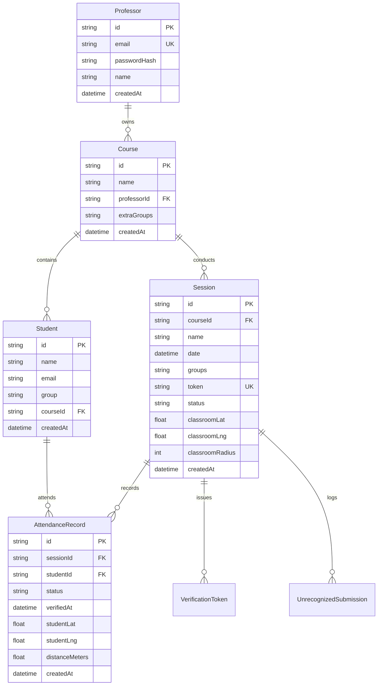

# 🎓 QR Attendance System

<p align="center">
  <strong>A full-stack, enterprise-grade QR attendance tracking platform designed for universities and higher education institutions.</strong>
</p>

<p align="center">
  
  
  
  
  
  
</p>

---

## 📋 Table of Contents

- [Overview](#-overview)
- [Key Features](#-key-features)
- [System Architecture](#-system-architecture)
- [One-Click Windows Launcher](#-one-click-windows-launcher)
- [Quick Start (Manual / Developers)](#-quick-start-manual--developers)
- [Excel Student Roster Format](#-excel-student-roster-format)
- [Worldwide Scanning (Cloudflare Quick Tunnel)](#-worldwide-scanning-cloudflare-quick-tunnel)
- [GPS Geolocation & Anti-Proxy Security](#-gps-geolocation--anti-proxy-security)
- [Professor & Student Workflow](#-professor--student-workflow)
- [REST API Reference](#-rest-api-reference)
- [Database Schema](#-database-schema)
- [Environment Configuration](#-environment-configuration)
- [Testing & Quality Assurance](#-testing--quality-assurance)
- [Project Structure](#-project-structure)
- [License](#-license)

---

## 🌟 Overview

The **QR Attendance System** solves attendance tracking in large university lectures and laboratory classes. Instead of passing around paper sign-in sheets or using expensive proprietary hardware, professors project a dynamic cryptographic QR code on the lecture hall screen. Students scan the code with their smartphone, submit their university credentials, and confirm their attendance via an anti-proxy verification pipeline.

The application is **100% free and open-source**, runs locally on the professor's computer, requires zero external cloud subscriptions or paid servers, and includes a single-click desktop shortcut that automates firewall configuration, local server launch, and public internet tunneling.

---

## ✨ Key Features

- **⚡ One-Click Desktop Launcher**: Launch the entire stack (Firewall unblocking, Node.js server, Cloudflare tunnel, and browser dashboard) via a single desktop shortcut.
- **🌐 Scan from Anywhere (Zero Port Forwarding)**: Uses Cloudflare Quick Tunnels (`trycloudflare.com`) to allow instant scanning across different Wi-Fi networks and mobile data (4G/5G) with **no router configuration, no accounts, and no fees**.
- **📍 Anti-Proxy GPS Geofencing**: Enforce physical classroom presence using GPS geolocation radius calculations (Haversine formula). Students outside the classroom cannot mark attendance.
- **👥 Flexible Group Management**: Native support for any subgroup format (e.g. `AIA 3.3A`, `AIA 3.1 B`, `ELA 2.2 A`, `Group 1`, etc.).
- **📊 Real-Time Live Monitoring (SSE)**: Server-Sent Events stream live attendance updates to the professor's screen as students register—no page refreshing required.
- **📥 Smart Excel Import & Downloadable Template**:
  - Drag-and-drop `.xlsx` student roster upload with instant validation preview.
  - Recognizes flexible headers (`Student Name`, `University Email`, `Group`, `THE Name`, `imai`, `Grupa`).
  - Auto-fallback for headerless and transposed (horizontal) spreadsheets.
  - Built-in **Download Template** button.
- **📤 One-Click Excel Export**: Export clean, color-coded `.xlsx` reports (Single Session or Multi-Session Course aggregate) with timestamps and attendance percentages.
- **🔒 2-Step Verification & Cryptographic Tokens**: Prevents link sharing using ephemeral session tokens and optional 15-minute one-time email verification links.
- **🖥 Projector & Fullscreen Mode**: High-contrast, scalable QR modal designed for large lecture hall projection screens.

---

## 🏗 System Architecture

```
                  ┌─────────────────────────────────────────┐
                  │       Professor Desktop / Laptop        │
                  │                                         │
                  │  ┌──────────────┐     ┌──────────────┐  │
                  │  │ Next.js App  │ <-> │ SQLite DB    │  │
                  │  │ (Port 3000)  │     │ (dev.db)     │  │
                  │  └──────┬───────┘     └──────────────┘  │
                  └─────────┼───────────────────────────────┘
                            │
               ┌────────────┴────────────┐
               │  Cloudflare Quick Tunnel│  (Zero-config HTTPS tunnel)
               └────────────┬────────────┘
                            │ Public Internet (https://*.trycloudflare.com)
            ┌───────────────┴───────────────┐
            │                               │
            ▼                               ▼
    ┌───────────────┐               ┌───────────────┐
    │ Mobile Phone  │               │ Mobile Phone  │
    │  (4G/5G Data) │               │(Outside Wi-Fi)│
    └───────────────┘               └───────────────┘
```

---

## 🚀 One-Click Windows Launcher

For professors on Windows, the system includes an automated launcher that configures the operating system and runs the entire stack in one click:

1. Double-click the **`QR Attendance System`** shortcut on your Desktop (or run `start.bat`).
2. When Windows requests Administrator elevation (*"Do you want to allow this app to make changes?"*), click **Yes**.
3. The launcher automatically:
   - Configures **Windows Defender Firewall** to allow Node.js on all profiles.
   - Opens inbound **TCP Port 3000**.
   - Switches the active Wi-Fi profile to **Private**.
   - Starts the Next.js server on `0.0.0.0:3000`.
   - Starts the public **Cloudflare Quick Tunnel**.
   - Opens your default web browser to the dashboard.

---

## 🛠 Quick Start (Manual / Developers)

### 1. Prerequisites
- **Node.js**: v18.17+ or v20+
- **npm**: v9+
- **Git**

### 2. Installation
```bash
git clone https://github.com/your-username/qr-attendance-system.git
cd qr-attendance-system
npm install
```

### 3. Environment Setup
Copy the example environment configuration:
```bash
cp .env.example .env
```
Key defaults in `.env`:
```ini
DATABASE_URL="file:./dev.db"
NEXTAUTH_SECRET="change-this-to-a-secure-random-32-char-string"
NEXTAUTH_URL="http://localhost:3000"
AUTH_TRUST_HOST="true"
APP_URL="http://localhost:3000"
SETUP_KEY="setup-key-2024"
```

### 4. Database Setup & Seeding
```bash
npx prisma generate
npx prisma migrate dev --name init
npm run db:seed
npm run db:excel
```

Default credentials:
- **Email:** `prof@university.edu`
- **Password:** `professor123`

### 5. Running the Application
```bash
# Development mode
npm run dev

# Production build and run
npm run build
npm start
```

---

## 📄 Excel Student Roster Format

The student roster can be imported via an Excel (`.xlsx`) spreadsheet. The system supports both vertical and horizontal layouts, and accepts any custom group names.

### Column Specification

| Column | Header Name | Description | Example Values |
|:---|:---|:---|:---|
| **Column 1** | `Student Name` / `Name` / `THE Name` | Full student name | `Alice Johnson`, `Popescu Andrei` |
| **Column 2** | `University Email` / `Email` / `imai` | Unique university email | `alice@university.edu`, `andrei@univ.ro` |
| **Column 3** | `Group` / `Groups` / `Grupa` | Subgroup / Lab section | `AIA 3.3A`, `AIA 3.1 B`, `ELA 2.2 A` |

### Sample Roster Table

| Student Name | University Email | Group |
|:---|:---|:---|
| Popescu Andrei | andrei.popescu@student.univ.ro | `AIA 3.3A` |
| Ionescu Maria | maria.ionescu@student.univ.ro | `AIA 3.1 B` |
| Radu Cristian | cristian.radu@student.univ.ro | `ELA 2.2 A` |
| Dumitrescu Elena | elena.dumitrescu@student.univ.ro | `AIA 3.3A` |
| Stan Alexandru | alexandru.stan@student.univ.ro | `ELA 2.1 B` |

> 💡 **Tip:** A ready-to-use template is available directly in the web dashboard under **Course $\rightarrow$ Import Excel $\rightarrow$ Download Template (.xlsx)**.

---

## 🌐 Worldwide Scanning (Cloudflare Quick Tunnel)

By default, local servers (`http://localhost:3000`) cannot be accessed by mobile phones on cellular data (4G/5G) or external Wi-Fi networks without complex router NAT port-forwarding or public IP addresses.

This system solves this seamlessly using **Cloudflare Quick Tunnels**:
- Integrated directly into `scripts/start-internet.js`.
- Generates a temporary, cryptographically signed HTTPS URL:
  `https://random-subdomain.trycloudflare.com`
- QR codes generated in the professor dashboard automatically encode this public tunnel URL.
- Students can scan and submit attendance from **any smartphone on any internet connection** with zero friction.

---

## 📍 GPS Geolocation & Anti-Proxy Security

To eliminate remote "proxy attendance" (students scanning QR screenshots sent by friends from outside class), the system provides an optional **GPS Geofence**:

```
                              [Classroom GPS Center]
                                       │
                         ╭─────────────┴─────────────╮
                         │      Allowed Radius       │
                         │         (e.g. 50m)        │
                         │                           │
                   [Student A]                       │
                  (Inside: OK)                       │
                         ╰───────────────────────────╯
                                                     
                                               [Student B]
                                            (Outside: REJECTED)
```

1. **Professor Session Setup**: Click *"Detect Current Location"* when creating a session. The system records your classroom's latitude, longitude, and accuracy radius.
2. **Student Check-In**: The student's mobile browser requests location permission upon opening the attendance page.
3. **Server Validation**: The server calculates the exact distance using the **Haversine formula**:
   $$d = 2r \arcsin\left(\sqrt{\sin^2\left(\frac{\Delta \varphi}{2}\right) + \cos(\varphi_1)\cos(\varphi_2)\sin^2\left(\frac{\Delta \lambda}{2}\right)}\right)$$
4. If $d > \text{allowed radius}$, the submission is rejected immediately.

---

## 🔄 Professor & Student Workflow

### 👨‍🏫 Professor Workflow
1. **Sign In**: Log into `/dashboard` using university credentials.
2. **Create / Select Course**: Upload students via `.xlsx` or manage groups.
3. **Start Session**: Pick the date, session name, targeted groups (`AIA 3.3A`, `AIA 3.1 B`, etc.), and optional GPS boundary.
4. **Project QR Code**: Open the session and click **Show QR Code** (or press fullscreen for projector mode).
5. **Monitor Live**: Watch student names appear in real-time as they verify attendance.
6. **Export**: Click **Export Excel** at the end of class to generate the finalized attendance sheet.

### 📱 Student Workflow
1. **Scan**: Scan the projected QR code using any smartphone camera.
2. **Enter Email**: Enter the official university email address.
3. **Location Check**: Grant location access for classroom geofence verification.
4. **Instant Confirmation**: Receive immediate confirmation of verified attendance.

---

## 🔌 REST API Reference

| Endpoint | Method | Auth | Description |
|:---|:---:|:---:|:---|
| `/api/auth/[...nextauth]` | `POST` | Public | NextAuth credentials sign-in & session handling |
| `/api/auth/register` | `POST` | Secret Key | Register new professor account (`SETUP_KEY` required) |
| `/api/courses` | `GET`, `POST` | Professor | List professor courses or create a new course |
| `/api/courses/[id]` | `GET`, `PATCH`, `DELETE` | Professor | Retrieve, rename, or delete a course |
| `/api/courses/[id]/students` | `GET`, `POST` | Professor | List enrolled students or upload `.xlsx` roster |
| `/api/courses/template` | `GET` | Public | Download sample `.xlsx` student roster template |
| `/api/courses/[id]/groups` | `GET`, `PATCH` | Professor | Query group counts, rename groups, or add extra groups |
| `/api/courses/[id]/export` | `GET` | Professor | Export multi-session Excel report for entire course |
| `/api/sessions` | `GET`, `POST` | Professor | List all sessions or create a new attendance session |
| `/api/sessions/[id]` | `GET`, `PATCH`, `DELETE` | Professor | Retrieve session details, toggle open/closed, or delete |
| `/api/sessions/[id]/qr` | `GET` | Professor | Generate QR code data URL and public attendance URL |
| `/api/sessions/[id]/stream` | `GET` | Professor | Server-Sent Events (SSE) real-time attendance stream |
| `/api/sessions/[id]/export` | `GET` | Professor | Export single session `.xlsx` attendance report |
| `/api/attend/[token]` | `GET`, `POST` | Public | Validate session token and submit student attendance |
| `/api/verify` | `GET` | Public | Verify one-time email attendance token |

---

## 🗄 Database Schema

The database is built on **SQLite** with **Prisma ORM** (7 models):



---

## 🧪 Testing & Quality Assurance

The application includes an extensive automated test suite covering unit, business logic, and parser testing:

```bash
# Run automated tests
npm test

# Run code linter
npm run lint

# Verify production build compilation
npm run build
```

### Test Coverage Highlights:
- **Excel Parser**: Tests standard headers, custom headers (`THE Name`, `imai`, `Groups`), Romanian headers (`Nume`, `Email`, `Grupa`), transposed horizontal layouts, email normalization, and row skipping.
- **Attendance Verification**: Tests duplicate detection, group assignment validation, and status transitions.
- **QR Generation**: Tests dynamic URL priority, Cloudflare tunnel overriding, and LAN IP fallback.
- **Email Delivery**: Tests SMTP payload construction and developer mode fallbacks.

---

## 📂 Project Structure

```
├── prisma/
│   ├── schema.prisma              # Prisma ORM schema & entity models
│   └── migrations/                # Database migration history
├── public/                        # Static assets & icons
├── scripts/
│   ├── start-internet.js          # Next.js + Cloudflare Tunnel co-runner
│   └── generate-pdf.js            # Standalone PDF documentation builder
├── seed/
│   ├── create-sample-excel.ts     # Sample student Excel generator
│   ├── create-demo-excel.ts       # 60-student demo Excel generator
│   └── students-sample.ts         # Database seeder script
├── src/
│   ├── app/
│   │   ├── api/                   # 15 REST route handlers
│   │   ├── attend/[token]/        # Student mobile attendance portal
│   │   ├── dashboard/             # Professor administration panel
│   │   │   ├── courses/           # Course management & Excel upload
│   │   │   └── sessions/          # Live attendance & QR presentation
│   │   ├── login/                 # Authentication portal
│   │   └── verify/                # 2-step email verification landing
│   ├── components/                # Reusable UI components & modals
│   ├── lib/
│   │   ├── auth.ts                # NextAuth v5 session config
│   │   ├── email.ts               # Email transporter & templates
│   │   ├── excel.ts               # ExcelJS parser & report generators
│   │   ├── groups.ts              # Group string parser/formatter
│   │   ├── prisma.ts              # Prisma singleton client
│   │   └── qrcode.ts              # QR generation & URL resolution
│   └── middleware.ts              # Route protection middleware
├── tests/                         # Jest test suites
├── start.bat                      # Windows all-in-one launcher
├── stop.bat                       # Server stop utility
└── unblock-firewall.bat           # Standalone firewall unblock script
```

---

## 📜 License

This project is licensed under the **MIT License**. You are free to use, modify, and distribute it for academic or commercial purposes.
